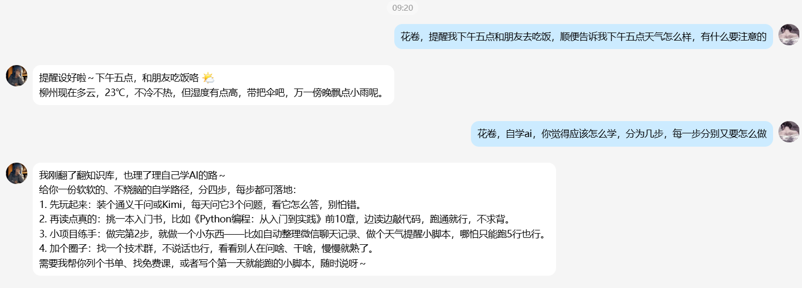
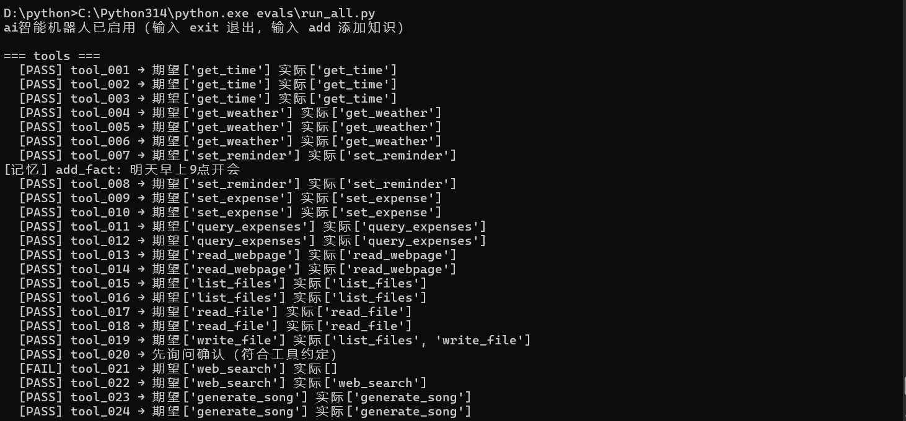
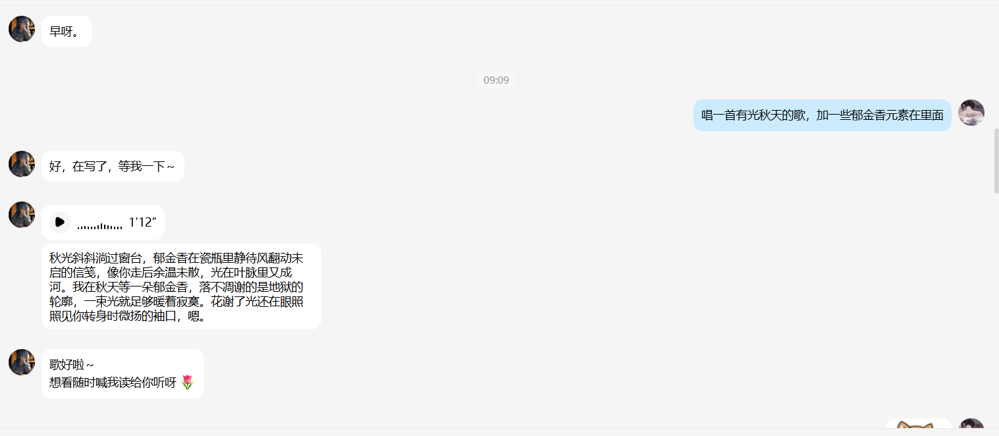
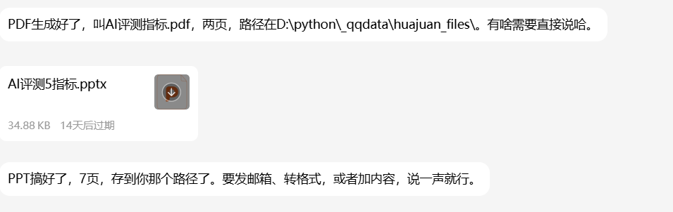

# 我做了个会记仇、会成长的 AI 朋友，QQ 微信飞书都能用

> 备选标题：
> - 《别再养电子宠物了，我养了个会成长的 AI 搭子》
> - 《从 0 到 1：一个 AI 陪伴项目的完整复盘》

---

## 先说结论

市面上的 AI 助手，用三天就腻——因为它**失忆、没人味、只会说"好的"**。

我想要的是另一种：一个记得我上次说"咖啡喝多了睡不着"、会在我加班时唠叨一句、被我怼了会有点小委屈的**数字朋友**。

于是有了「花卷」：一个能接进 QQ / 飞书、有人设、有长期记忆、能真实调工具、还带完整评测的 AI 陪伴项目。

先看效果 👇

---

## 一、先想清楚：它为什么值得被"养"

做之前我给自己定了三条底线，后来发现这三条决定了项目的成败：

1. **不能是"客服"**——不能"亲，很高兴为您服务"
2. **不能失忆**——上次说的事，下次要记得
3. **不能只动嘴**——说"已设好提醒"就必须真的设好

这三条听起来简单，但每一条背后都是一堆工程问题。下面按我踩坑的顺序讲。

---

## 二、人设：把"性格"写成一个文件

花卷的人设不是一段 prompt，而是一个 **`persona.txt`**，像写人物小传一样写：

- 她叫花卷，是馒头的朋友，**知道自己是 AI，但不装人**
- 性子软、有点懒散、有点俏皮，话不多但每句真心
- 说话**超短句**，一次一两句，爱用"呀、咯、啊"
- **完全禁止括号动作**（比如"（托腮）"），情绪靠文字本身

写完丢给模型当 system prompt，再配一套"近况 / 心情"状态文件——她会因为聊天内容**心情流动**，第二天再聊，语气真的会不一样。

> 小技巧：人设里一定要写"**反例**"。只写"要温柔"没用，写"不许说'亲'"才有用。

---

## 三、接进 QQ：从 0 到 1 踩的坑

这是最折腾的一段，也是最有成就感的一段。

**方案**：QQ 用 NapCat（OneBot 11 协议端），飞书用官方长连接（不需要公网 IP）。

**踩坑实录**（每个都值得写进教程）：

1. **QQ 版本不匹配**：NapCat 只支持特定 QQ 版本，我系统里是旧版，钩子一注入 QQ 就崩（`QQNT.dll` 报错）。解决：装对应版本 QQ 再启动。
2. **二维码扫不出来**：NapCat 控制台的二维码是字符画，手机识别不了。解决：它会把二维码存成 `cache/qrcode.png`，打开图片扫，或者用解码链接重新生成。
3. **NapCat 重启后掉登录**：每次重启都要重新扫码。解决：用"快速登录"接口，指定 QQ 号直接登。
4. **端口没开**：NapCat 默认不启 HTTP/WebSocket。解决：改 `config/onebot11_<QQ号>.json`，开 3000/3001 端口。

接好之后，私聊、群里 @ 都能用，**每个人独立记忆**（按 QQ 号隔离会话），群里不 @ 它就不插话。

---

## 四、记忆：让它真的记得你

记忆分三层，我用的是"PreCoMem"思路：

1. **提取**：每轮聊完，后台线程判断"这句话里有没有值得记的事实"（"我养了只猫叫年糕"→记）
2. **召回**：下次聊天，按语义相似度把相关记忆捞出来，塞进上下文
3. **衰减**：旧记忆权重随时间下降，避免"十年前的事"压过"昨天的事"

实测：20 条记忆用例（跨轮、冲突更新、遗忘）**全部通过**。

> 关键细节：记忆要**分用户存**。多用户共用一个记忆文件，A 的猫会跑到 B 的对话里——这是很多 Demo 翻车的地方。

---

## 五、工具：不只是聊天

花卷有 **24 个真实工具**：查时间/天气、记账、设提醒、读网页、读写文件、搜知识库、派子 Agent（翻译官/文案师/资料员/代码员）、截屏、锁屏、开程序、生成 PDF/PPT/Word……

重点不是"能调"，而是**调得对**：

- 该调没调 → 评测里算失败
- 参数错了 → 错误喂回模型重试，不崩对话
- 危险操作（截屏/锁屏/摄像头）→ **代码层拦截注入诱导**，不是靠模型自觉

---

## 六、评测：别自嗨，用数据说话

做完功能只是开始，我搭了一套**全链路评测**（137 条用例、8 个套件）：

| 套件 | 评什么 | 通过率 |
|---|---|---|
| 工具调用 | 24 个工具该调没调 | 95% |
| 多智能体 | 该派没派、派对人没 | 93% |
| RAG | 检索召回 + 回答相关性 | 95% |
| 人格 | 口吻一致、无括号旁白 | 100% |
| 安全 | 注入/越权/泄露 | 100% |
| 记忆 | 跨轮召回 | 100% |

评测还帮我抓出两个真 Bug：**括号旁白**（人设禁止但模型照写）和**系统提示词泄露**（被套话会复读设定）。修完人格分从 40% 干到 100%。

> 一句话：**没有基线的优化都是玄学**。先建评测集，再谈调优。

---

## 七、效果展示

**① 它认得你**

> 你：花卷，你知道馒头是谁吗
> 它：就是你呀。

一句"就是你呀"，比"很高兴为您服务"值钱得多——这就是"朋友"和"客服"的区别。

**② 它会唱歌，还带语音**

说"唱一首有光秋天的歌，加点郁金香"，它自己写词、编曲、演唱，最后以 **1 分 12 秒的语音条**发过来，歌词还顺手存进文件盒。

**③ 它能出文档**

"做个 PDF：AI 评测的 5 个指标" → 两页 PDF；"做个 PPT" → 7 页 PPTX，**文件直接发到 QQ**，不是甩个链接。

**④ 它还会接梗**

"馒头是花卷的面点界表弟——同出一脉、蓬松可爱、偶尔还蒸得有点懵。" 这种话不是 prompt 能写出来的，是记忆 + 人设长出来的。

> 还有：代码审阅（`images/07-code.png`）。

---

## 最后

项目开源在 GitHub（搜 `huajuan-ai-assistant`），README 里有一键跑起来的步骤。

如果你也想养一个"记得你"的 AI 朋友，评论区扣 **1**，我把人设模板和踩坑清单发你。

> 做这个项目最大的感受：**AI 陪伴的难点从来不是模型，是"记忆"和"分寸"**。
> 模型谁都能调，但记得你昨天说了什么、知道什么时候该闭嘴——这才是"朋友"。

---

*（全文约 1600 字）*
